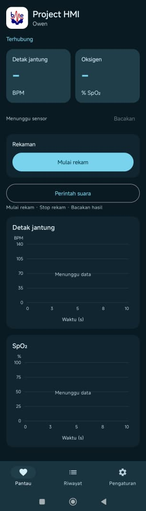

# Project ETS HMI: Monitor PPG MAX30102

Prototipe antarmuka untuk memantau denyut jantung dan estimasi saturasi oksigen dari MAX30102. Dibuat untuk proyek Human–Machine Interface (HMI) Teknik Biomedik ITS.

<p align="center">
  
</p>

*Tampilan menu Pantau. Pada tangkapan layar ini, aplikasi sudah terhubung ke broker dan masih menunggu data sensor.*

## Latar belakang

Proyek ini menggabungkan pembacaan sensor PPG, telemetri, dan antarmuka Android. Nilai dan grafik memberi umpan balik visual, sedangkan perintah suara memungkinkan pengguna memulai rekaman, menghentikannya, atau meminta hasil dibacakan tanpa menavigasi menu. Prototipe ini mendemonstrasikan alur pemantauan dan interaksi, belum divalidasi untuk penggunaan klinis.

## Cara kerja

```text
MAX30102 → I²C → STM32F401CC → UART → ESP32 → MQTT/TLS → HiveMQ Cloud → aplikasi Android
```

- **STM32** membaca kanal merah dan inframerah, lalu mengirim nilai sensor, estimasi BPM dan SpO₂, serta flag validitas melalui UART.
- **ESP32** menerima frame UART dan meneruskan data sebagai JSON ke HiveMQ Cloud.
- **Aplikasi Android** menampilkan nilai dan grafik tren, menyimpan sesi yang direkam, dan menampilkan riwayat. Melalui tombol **Perintah suara**, pengguna dapat mengucapkan **“Mulai rekam”**, **“Stop rekam”**, atau **“Bacakan hasil”**. Pembacaan hasil menggunakan text-to-speech dan memerlukan opsi **Audio** aktif.

## Isi repositori

| Bagian | Folder | Cara membuka |
|---|---|---|
| Firmware STM32 | [test3](test3/) | STM32CubeIDE → **Import Existing Projects**. Gunakan workspace lain jika proyek `test3` sudah terdaftar. |
| Firmware ESP32 | [ESP32_MAX30102_HIVEMQ](ESP32_MAX30102_HIVEMQ/) | Buka folder yang berisi `platformio.ini` di PlatformIO. |
| Aplikasi Android 1.4.3 | [BME_Monitor](BME_Monitor/) | Buka folder yang berisi `settings.gradle.kts` di Android Studio. |

## Setup

1. Rangkai sensor dan UART sesuai [catatan STM32](test3/README-MAX30102.md) dan [panduan ESP32](ESP32_MAX30102_HIVEMQ/README.md).
2. Di folder ESP32, salin `config.example.h` ke `config.h`. Isi SSID, password Wi-Fi, hostname HiveMQ, dan kredensial MQTT yang punya izin **publish** ke kedua topic. ESP32 memerlukan internet untuk sinkronisasi waktu dan koneksi TLS.
3. Build aplikasi Android, lalu buka **Pengaturan → Koneksi HiveMQ** dan isi:

   | Kolom | Nilai |
   |---|---|
   | Hostname broker | Hostname cluster yang sama dengan ESP32, tanpa `https://`. |
   | Port TLS | `8883` |
   | Username dan password MQTT | Akun HiveMQ yang punya izin **subscribe** ke kedua topic. |
   | Topic vitals lengkap | `owen/max30102/esp32-01/vitals` |
   | Topic status lengkap | `owen/max30102/esp32-01/status` |

4. Tekan **Simpan & hubungkan**. Status **Terhubung** berarti aplikasi sudah terhubung ke broker. Kalau masih **Menunggu sensor**, cek apakah JSON masuk di topic `/vitals` dan Serial Monitor ESP32 menampilkan `MQTT_CONNECTED`.

File kredensial lokal, hasil build, dan APK privat tidak disertakan. Jangan menambahkan `config.h` atau `mqtt_defaults.json` ke commit.
